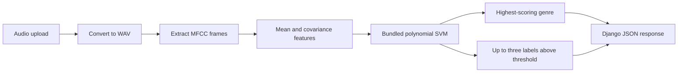

# Audio genre classifier

A legacy Django and scikit-learn prototype that accepts an audio upload, extracts MFCC-based features, and returns one or more predicted music genres from bundled SVM artifacts.

The repository captures an earlier music-information-retrieval experiment and its web interface. It is useful as a study of feature extraction and classifier integration, but it is not a current benchmark or production audio service.

## Classification flow



The `mysvm` package contains audio feature extraction, label helpers, SVM training utilities, accuracy helpers, and inference functions. The Django application manages uploads and calls that package from its request handlers.

## Implemented components

| Component | Location | Purpose |
|---|---|---|
| Feature extraction | `mysvm/feature.py`, `featureExtract.py` | Audio conversion and MFCC-derived features |
| Classification | `mysvm/svm.py` | SVM training, probability, and genre helpers |
| Metrics helper | `mysvm/acc.py` | Array-level accuracy calculation |
| Model artifacts | `mysvm/data/` | Serialized classifiers and feature arrays |
| Web application | `fileupload/` | Upload models, views, routes, templates, and static UI |
| Project configuration | `django-jquery-file-upload/` | Django settings, URL routing, and WSGI entrypoint |

## Historical experiment

The original project report describes experiments with KNN, logistic regression, and linear, RBF, and polynomial SVMs. It reports approximately 64–65% test accuracy for a ten-genre polynomial SVM and 85% for a selected six-genre subset.

Treat those numbers as historical notes, not reproduced results. The repository does not provide a complete dataset manifest, deterministic split, evaluation script, environment lock, or run artifact that independently verifies the table. Dataset selection and class-subset search can also materially affect the reported accuracy.

## Local setup boundary

The code targets an older Python/Django/scikit-learn stack listed in `requirements.txt`. A compatible isolated environment and system audio conversion tools are required before attempting to run it.

The historical startup sequence is:

```bash
python -m venv .venv
source .venv/bin/activate
pip install -r requirements.txt
python manage.py migrate
python manage.py runserver
```


## Inference modes

- Single-label mode returns the highest-scoring genre.
- Multi-label mode selects up to three genres whose probability exceeds the configured threshold.
- Uploaded files are converted when necessary before feature extraction.

The selected labels described by the historical report are classical, hip-hop, jazz, metal, pop, and rock. Inspect the bundled classifier metadata and label helpers before assuming every artifact uses the same class set.

## Safety and reproducibility boundaries

- Serialized pickle/joblib model files must be treated as executable data and loaded only when their provenance is trusted.
- File uploads need strict type, size, storage, timeout, and deletion controls before public deployment.
- Audio conversion invokes format-specific tooling and should run in a constrained environment.
- The bundled static assets and training artifacts need provenance and licensing review before redistribution.
- Genre is subjective, and evaluation should document dataset balance, class definitions, splits, and per-class metrics.
- No assertion-based automated test suite is currently included.

## Best modernization milestone

Before updating the web framework, first make the experiment reproducible: document the dataset, remove duplicate artifacts, define a deterministic split, rebuild one baseline pipeline, report a confusion matrix and per-class scores, and export a model with explicit feature/label metadata. That would make later API or UI modernization technically meaningful.

## Included research material

`report.pdf` and `report.docx` preserve the original project narrative. They are supporting historical artifacts; the concise README is the authoritative statement of what can currently be verified from source.

## License

See `LICENSE.txt`.
